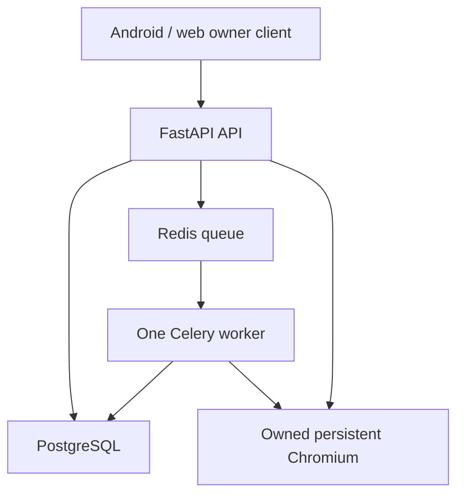

# JobTomatik

**Autonomous job hunting. Truthful applications. Evidence-backed outcomes.**

[](https://github.com/TheHighBrid/JobTomatik/releases/latest)
[](https://github.com/TheHighBrid/JobTomatik/issues)

JobTomatik discovers and ranks jobs, prepares tailored materials, resolves employer application targets, fills supported forms and tracks the outcome. Its final goal is policy-bounded autonomous submission, confirmation, recovery and follow-up. Android and the web provide the owner interface; a Linux OneHost server owns execution.

**Current position, 2026-10-16:** JT5 execution and owner handoff are integrated through [#704](https://github.com/TheHighBrid/JobTomatik/pull/704). The implementation has recorded OVH deployment evidence. General autonomous operation is not certified. [#706](https://github.com/TheHighBrid/JobTomatik/pull/706) fixes an outstanding live-submit flag defect and remains an undeployed draft with a Codacy action required.

[Status](docs/PROJECT_STATUS.md) · [Product](docs/PRODUCT.md) · [Roadmap](docs/ROADMAP.md) · [Evidence](docs/EVIDENCE.md) · [Costs](docs/COSTS_AND_INFRASTRUCTURE.md) · [The Famiglia](docs/GOVERNANCE.md)

## What JT5 delivers

One authenticated **Apply** action reserves and dispatches a target-bound attempt. Read-only status follows its progress. Authentication, ownership, atomic duplicate prevention and honest uncertain-outcome reconciliation are the four core protections. Target integrity, privacy and deployment release controls remain part of reliable execution.

- Discover, score and queue suitable jobs using the owner's approved preferences.
- Prepare truthful application materials and reuse approved answer policies.
- Resolve discovery listings into employer/ATS targets and bind execution to that identity.
- Complete supported forms and retain the original browser for genuine human-only steps.
- Record evidence, prevent duplicate execution and preserve uncertainty when confirmation is missing.
- Recover interrupted work and advance toward bounded unattended operation, adapter by adapter.

Current features and final expectations are mapped separately in [the product contract](docs/PRODUCT.md). Unsupported sites and sensitive unanswered questions require a clear review boundary.

## Status at a glance

| Area | Verified position | Remaining boundary |
|---|---|---|
| Main integration | #704 merged as `6aac5b3`; tested implementation `1a8a0c7` | Merge is not a new published APK release |
| Exact-head checks | #704 implementation: 25 success, 2 skipped | Evidence applies to that exact head |
| OneHost | Startup, queue, browser, native handoff and restart checks recorded | Host administration offline at documentation refresh |
| Owner handoff | Retained browser, transient read recovery and once-only final action integrated | A click is not employer confirmation |
| Live release control | #706 implements API/worker flag enforcement and withdrawal fixes | Open draft, Codacy action required, not deployed |
| Latest real outcome | One final action recorded; no employer receipt | User Applied status and uncertain automation remain distinct |
| Unattended operation | Final product objective | Not generally certified |
| Costs | No new infrastructure purchased by this refresh | Actual monthly/cumulative totals need invoices and usage |

See [completed tasks and the prioritized to-do list](docs/PROJECT_STATUS.md) for closure evidence and outstanding work. No completion percentage or final delivery date is presented as established fact.

## Architecture



The API and worker share browser state, network/PID namespaces and a private native display on one Linux host. Celery uses a solo pool with concurrency 1. Beat is absent. Worker startup reconciles interrupted attempts before consuming new work.

**Supported production path:** OVH Linux VPS plus Docker Compose, PostgreSQL, Redis, FastAPI, Celery and Playwright-owned Chromium. Android is a thin client. Termux, PRoot, ADB and native Android Chrome instructions remain historical; they are not the current production boot path.

## Deploy and develop

Start with [OneHost production deployment](docs/operations/ONEHOST_PRODUCTION_DEPLOYMENT.md) and its [environment template](docs/operations/onehost-production.env.example). Configure stable secrets and the exact runtime revision before starting services:

```bash
git clone https://github.com/TheHighBrid/JobTomatik.git
cd JobTomatik
# Configure required secrets and revision as described in the deployment guide.
docker compose -f docker-compose.onehost-production.yml config
docker compose -f docker-compose.onehost-production.yml up -d --build
```

The default API bind is localhost. Use approved TLS ingress for remote clients. Never commit populated environment files, browser profiles, applicant records or credentials.

**Known release-control issue:** on the documented main snapshot, `ALLOW_REAL_APPLICATION_SUBMIT=false` is not sufficient evidence that JT5 Apply is blocked. Complete #706 integration and deployed verification before relying on that control. Documentation does not enable production submission or authorize a real application.

Build tooling is pinned in [.jobtomatik-toolchain.env](.jobtomatik-toolchain.env). Use the repository's existing verification workflows and scripts; historical commands do not certify a new source revision.

## Android and release identity

| Identity | Current source / publication |
|---|---|
| Repository candidate | `2.1.1` in [VERSION](VERSION) |
| Android defaults | version name `2.1.1`, version code `211` |
| Application ID | `ca.jobtomatik.app` |
| Minimum / target SDK | 23 / 35 |
| Latest published GitHub release observed | [v2.1.0](https://github.com/TheHighBrid/JobTomatik/releases/tag/v2.1.0), 2026-09-05 |
| JT5 | Execution architecture name; not an Android version |

[Download published artifacts](https://github.com/TheHighBrid/JobTomatik/releases/latest). A successful build is not publication. Check the exact release artifact, signing identity and upgrade compatibility before installation. See [APK build instructions](BUILDING_APK.md) and [release notes](docs/RELEASE_NOTES_JT5.md).

## Roadmap

1. Close release-control and outcome-semantics defects with exact-head evidence.
2. Verify the deployed correction and complete supported-host operational acceptance.
3. Reconcile remaining PRs, platform acceptance and Android release provenance.
4. Certify supported application paths and then run a bounded unattended pilot.
5. Expand ATS coverage without weakening reliable shared execution.

[Milestones, dependencies, planning ranges and alternatives](docs/ROADMAP.md) explain what completes each stage. Historical campaign dates do not guarantee delivery.

## The Famiglia

| Title | Participant | Function |
|---|---|---|
| Don | `TheHighBrid` | Founder, product owner, final authority and repository administration |
| Underboss | Sol 5.6 | Standing integration and verification lead |
| Caporegime | Sol 6.1 | Assigned critical-path implementation/review |
| Consigliere | Advisory seat, unappointed | Independent advice when assigned |
| Caporegime / Soldatos | Manus, Claude and other assigned contributors | Bounded workstreams and engineering |
| Associates | Dependency, CI and review automation | Proposals and evidence, no release authority |

The [full roster](docs/GOVERNANCE.md) maps aliases to known identities, distinguishes active from historical participation and retains Grok's inactive status. Titles are creative project names and do not change GitHub accounts or permissions.

## Contributing, security and attribution

Read [AGENTS.md](AGENTS.md), [the coordination board](docs/operations/AI_COOPERATION_BOARD.md) and [issue #252](https://github.com/TheHighBrid/JobTomatik/issues/252) before claiming a lane. Use a dedicated branch, exact-head verification and a clear handoff. Preserve existing source authorship when using project aliases.

Security reporting is described in [SECURITY.md](SECURITY.md). Authorship and copyright/disclaimer scope are in [AUTHORS.md](AUTHORS.md) and [NOTICE.md](NOTICE.md). No root software license is currently established; public visibility is not an unrestricted reuse grant.

## Documentation map

| Document | Purpose |
|---|---|
| [Project status](docs/PROJECT_STATUS.md) | Completed work, blockers, operational matrix and prioritized to-do list |
| [Product contract](docs/PRODUCT.md) | Goals, features, robustness and final delivery expectations |
| [Roadmap](docs/ROADMAP.md) | Milestones, dependencies, estimates and alternatives |
| [Evidence ledger](docs/EVIDENCE.md) | Exact SHAs, checks, artifacts and confidence boundaries |
| [Costs and infrastructure](docs/COSTS_AND_INFRASTRUCTURE.md) | Machine observations, actual-cost gaps and future cost model |
| [Governance](docs/GOVERNANCE.md) | Famiglia aliases, authority, authorship and professional working rules |
| [JT5 coordination blueprint](docs/architecture/JT5_MULTI_AGENT_COORDINATION_BLUEPRINT.md) | Current execution sequence and lane rules |
| [Production cutover](docs/operations/JT5_PRODUCTION_CUTOVER_CHECKLIST.md) | Recorded integration versus remaining release acceptance |

Historical snapshots are retained under `docs/archive/` for provenance. Current status and explicit owner instructions take precedence over their outdated runtime, authority or schedule claims.
